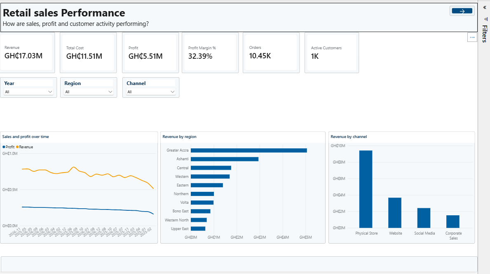
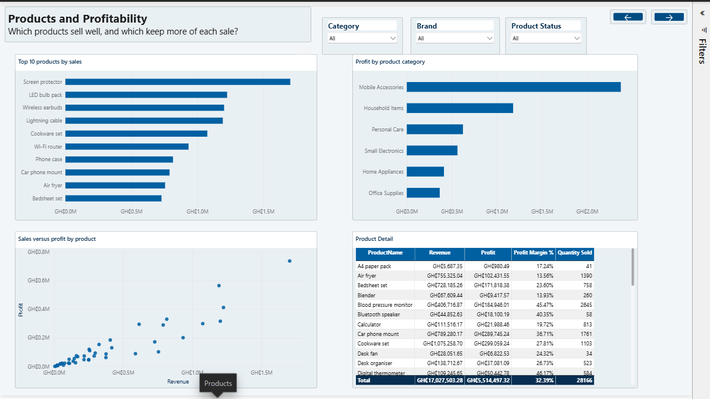
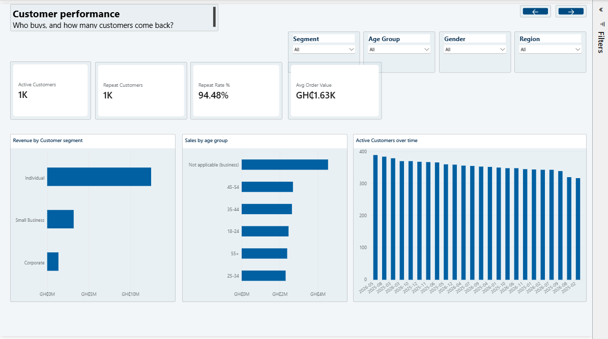

# Retail Sales Performance Dashboard

This Power BI project examines two years of sales activity for a fictional Ghanaian retailer. It brings together transaction, product, customer, store, region, salesperson, channel, and returns data to show where revenue and profit come from, how they change over time, and how customers and products contribute to performance.

The report contains five pages: **Overview**, **Sales Trends**, **Products**, **Customers**, and **Channels & Returns**. Across those pages are 66 visuals supported by a semantic model with 22 DAX measures.

## Dashboard previews

The images below show the five report pages.

### Overview



### Sales Trends


### Products



### Customers



### Channels & Returns


## What the report covers

- **Overview:** revenue, profit, cost, margin, completed orders, active customers, and performance by time, region, and channel.
- **Sales Trends:** monthly and quarterly revenue, prior-year comparisons, quantity sold, and average order value.
- **Products:** revenue and profit by product and category, with a product performance table.
- **Customers:** active and repeat customers, repeat rate, order value, and revenue by segment and age group.
- **Channels & Returns:** order status, channel and store performance, return rate, returned units, and return reasons.

## Data

The supplied exercise data is fictional. It covers sales dated in 2025 and 2026 and is provided as eight CSV files in `data/raw/`.

| File | Rows | Contents |
|---|---:|---|
| `sales_transactions.csv` | 10,807 | Transaction lines and order details |
| `customers.csv` | 1,500 | Customer attributes and registration dates |
| `products.csv` | 42 | Product catalogue and standard costs |
| `regions.csv` | 10 | Region lookup |
| `stores.csv` | 16 | Store details and region assignments |
| `salespeople.csv` | 26 | Salesperson details |
| `channels.csv` | 4 | Sales-channel lookup |
| `returns.csv` | 355 | Return events and reported quantities |

## Measures and reporting rules

Revenue, cost, profit, and order counts are calculated for completed orders. Revenue is net of discounts; profit is revenue less cost. Average order value is revenue divided by the distinct count of completed orders. The report uses Ghana cedi formatting for financial measures and percentage formatting for rate measures.

The Sales Trends page opens with 2026 selected in its Year filter. The year-over-year measure compares the selected period with the equivalent prior-year dates. For a full-year comparison, keep 2026 selected; the supplied date table has no sales dates for 2024.

The date filter on **Channels & Returns** follows the sales order date. Return measures therefore describe returns against orders placed in the selected sales period. Some orders placed in 2025–2026 have return events dated in January 2027, so those returns can still appear when the corresponding sales period is selected.

## Data preparation

The Power Query steps standardize data types and text, clean date fields, join lookup data, and derive sales values. The model applies these rules:

- A missing discount or a discount greater than 100% is treated as zero. Discounts of 50% or more are flagged for review and retained.
- Where the sales row's region differs from its store's region, the store lookup supplies the reporting region.
- A missing unit cost is filled from the product catalogue's standard cost. Sales rows with product ID `P999`, which has no matching catalogue entry, are excluded from the model.
- Duplicate detection includes `OrderID`. Rows with different order IDs remain separate transactions, even when their other values match.
- One return event has no reported quantity. The model treats that quantity as one unit, marks it as imputed, and uses a whole-number field for the returned-units measure.

These rules are stated here so the report's totals can be interpreted in context.

## Open and refresh the project

1. Keep `Project Analysis 1.pbip`, `Project Analysis 1.Report/`, and `Project Analysis 1.SemanticModel/` together in the project folder.
2. Open `Project Analysis 1.pbip` in Power BI Desktop.
3. In Power Query, open **Manage Parameters** and set `pDataFolder` to the full path of the repository's `data/raw/` folder. The parameter is shared by all eight source queries.
4. Refresh the model and save the project.

The parameter currently points to the folder used to prepare this copy. Anyone cloning the repository should set it to their own local `data/raw` path before refreshing.

## Repository layout

```text
Project Analysis 1.pbip
Project Analysis 1.Report/
Project Analysis 1.SemanticModel/
data/raw/
  channels.csv
  customers.csv
  products.csv
  regions.csv
  returns.csv
  sales_transactions.csv
  salespeople.csv
  stores.csv
screenshots/
  overview.png
  sales trend.png
  products.png
  customers.png
  channels and returns.png
README.md
```

The report and semantic model folders belong beside the `.pbip` file. Keep their theme resources and `.platform` metadata with the project. Local Power BI settings and generated cache files are excluded by `.gitignore`.

## Tools

Power BI Desktop, Power Query (M), DAX, and the Power BI Project format (`.pbip`).
